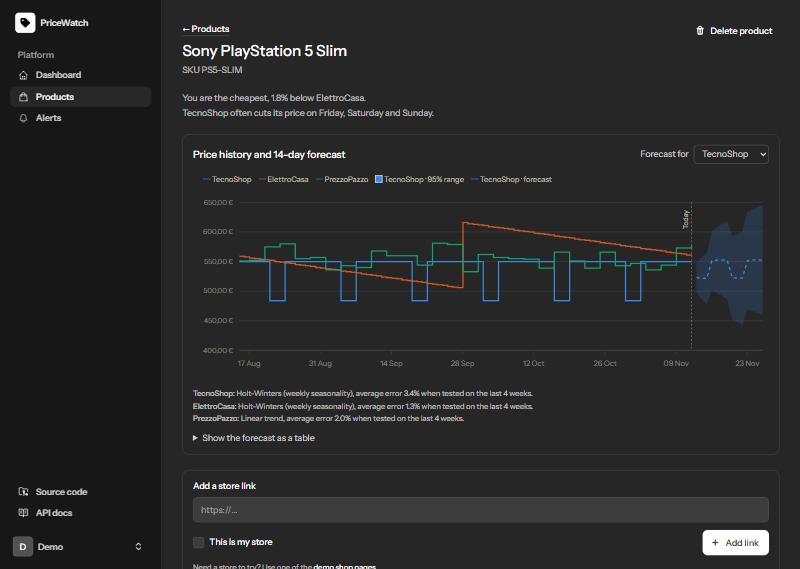
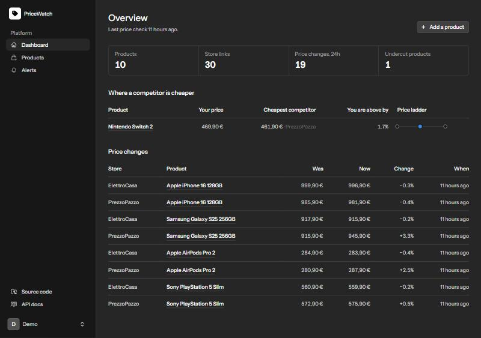
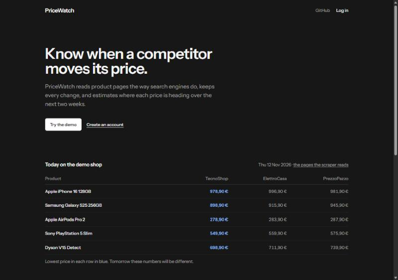

# PriceWatch

Competitor price monitoring with forecasts, built with Laravel 13, Livewire 4 and Pest.

Add a product, paste the pages of the stores that sell it, and PriceWatch reads
each price every few hours, keeps the history, alerts you when a competitor
undercuts you, and estimates where every price is heading over the next 14
days, with the error it actually made on past data printed next to it.



| Dashboard | Home page |
|---|---|
|  |  |

## Try it locally

Requirements: PHP 8.4.1+ with `pdo_sqlite`, Composer, Node 22+. No Docker needed.

```bash
git clone https://github.com/ESSEM01/pricewatch.git && cd pricewatch
composer setup          # install, .env, key, migrate, npm install + build
php artisan db:seed     # demo account: 10 products × 3 stores, 180 days of history
composer dev            # web server, queue worker and Vite
```

In a second terminal, start the scheduler so prices are checked every few hours
and forecasts refresh nightly:

```bash
php artisan schedule:work
```

Open http://localhost:8000 and press **Try the demo**, or log in as
`demo@pricewatch.test` / `password`. The demo account is shared, so its
settings (profile, password, 2FA, passkeys, API tokens, account deletion) are
read-only.

### Running a public demo

The **Try the demo** button is on by default only with `APP_ENV=local`. On a
public server, opt in and rebuild the shared account every night, since
visitors can change its products and alerts:

```dotenv
DEMO_LOGIN=true
DEMO_NIGHTLY_RESET=true   # runs demo:reset at 04:00 (needs the scheduler)
```

The demo stores live inside the app at `/demo-shop`: fictional shops whose
prices move every day (fortnightly weekend promos, a slow downward cycle,
random noise), so the scraper always has real pages to read without touching
third-party sites.

## What it does

- **Reads prices** from schema.org JSON-LD, then OpenGraph tags, then an
  optional per-store CSS selector, on PHP's native HTML5 parser.
  `"1.299,00 €"`, `"€ 1,299.99"` and `1299.00` all become `129900` cents.
- **Scrapes politely and safely**: honours `robots.txt` (RFC 9309), a few
  requests per minute per store, back-off after repeated errors, and an SSRF
  guard that refuses private networks, odd ports and schemes, pins the vetted
  IP against DNS rebinding and re-checks every redirect.
- **Stores only changes** plus a daily heartbeat, as integer cents.
- **Forecasts 14 days** per store. Moving average, linear trend and
  Holt-Winters (weekly season) are backtested walk-forward on the last four
  weeks; the least wrong one wins and its MAPE is shown. A 95% band widens
  with the horizon. Recurring weekday promotions are detected and named.
- **Alerts** by mail and in the app when a competitor goes below your price,
  any store goes below a threshold, or a price moves by N%. Rules fire on
  crossing, at most once per day.
- **Read-only REST API** with personal tokens. See [docs/API.md](docs/API.md).

## How it is built

```
app/
├── Scraping/            UrlGuard (SSRF) → RobotsPolicy → PageFetcher → HtmlPriceExtractor
│   ├── Extractors/      JsonLd, OpenGraph, CssSelector (strategy pattern)
│   └── Money/           PriceParser: locale-aware text → cents
├── Forecasting/         DailySeries, Backtester, ModelSelector, Forecaster
│   ├── Models/          MovingAverage, LinearTrend, HoltWinters
│   └── Signals/         WeeklyPromoDetector
├── Alerts/              AlertEvaluator (crossing rules, atomic 24h cooldown)
├── Jobs/                ScrapeListing (rate-limited per store), RefreshForecast
├── Events/              PriceChanged → EvaluateAlertRules, RefreshForecastOnPriceChange
└── DemoShop/            Deterministic price simulator behind /demo-shop
resources/views/pages/   Livewire 4 single-file pages (dashboard, products, alerts, settings)
```

The scheduler runs `scrape:due` every 10 minutes (it leases due listings and
queues one job each) and `forecasts:refresh` nightly. Product pages only read
precomputed forecasts, so they stay fast.

Design choices worth a conversation are listed in [docs/PLAN.md](docs/PLAN.md):
why integer cents, why simple statistics with an honest backtest instead of
machine learning, and how this would scale (per-domain queues, proxy
rotation, headless rendering, TimescaleDB).

## Quality

```bash
composer test   # Pint, Larastan level 7, Pest (331 tests)
```

CI runs the same checks plus `composer audit` on every push. The test suite
uses HTML fixtures for the extractors, a fake DNS for the SSRF guard,
synthetic series with known answers for the forecasting models, and
`Http::fake()` for everything that would touch the network.

## Limits

- Pages that render their price with JavaScript only are not supported;
  a headless browser (Browsershot, Panther) would be the next step.
- Forecasts are statistical estimates from the store's own history; they
  know nothing about stock, campaigns or competitors' plans.
- The demo stores are fictional; the brand names are only product labels.
